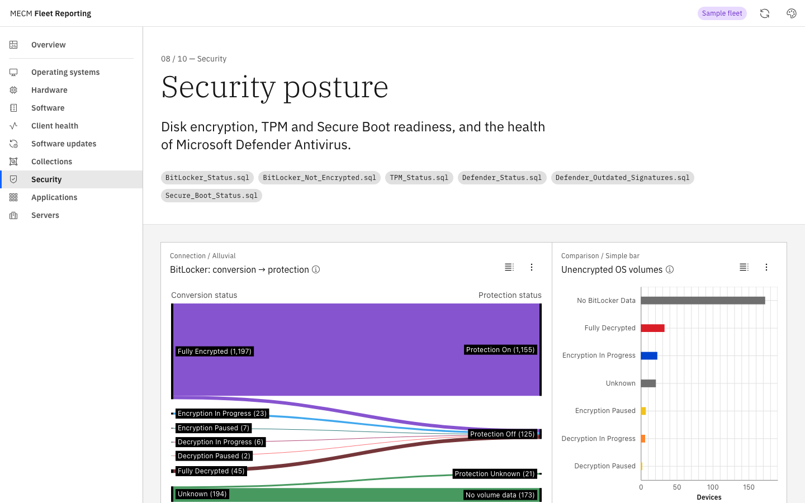

# MECM Carbon Dashboards

A web dashboard set for the queries in this repository, built on IBM's [Carbon Design System](https://carbondesignsystem.com) (`@carbon/react` + `@carbon/charts-react`). It runs the `.sql` files themselves, so the queries in this repo stay the single source of truth: change a query, reload the page.



- **10 dashboards**: an overview plus one per query category
- **All 44 queries**, each shown with the Carbon chart that fits its data shape, plus a sortable, searchable records table
- **Live or sample**: connects to your site database, or runs against a built-in, internally consistent sample fleet when no server is configured
- **Styled after [carbondesignsystem.com](https://carbondesignsystem.com)**: Gray 10 content under a white UI shell by default, with White, Gray 90 and Gray 100 in the theme panel. Chart and status colors follow the chosen theme

## Quick start

Requires Node.js 20.19 or newer (22 LTS recommended).

```bash
cd dashboards/carbon
npm install
npm run build
npm start          # http://127.0.0.1:4173
```

With no `.env`, the dashboards run against the sample fleet and the header shows a purple **Sample fleet** tag.

For development with hot reload, run `npm run dev` instead of `build` + `start`.

## Connecting to your site database

```bash
cp .env.example .env
```

Set `MECM_SQL_SERVER` to the site database server and `MECM_SQL_DATABASE` to the site database, which is `CM_<site code>` by default:

```ini
MECM_SQL_SERVER=cm-sql01.contoso.com
MECM_SQL_DATABASE=CM_PS1
```

The site database server is the one with the **Site database server** role under **Administration > Site Configuration > Servers and Site System Roles** in the console. Then pick an authentication mode:

| `MECM_SQL_AUTH` | Use when | Needs |
|---|---|---|
| `windows` (default) | The server runs on Windows as an account with database access | `msnodesqlv8` (installed automatically on Windows) and ODBC Driver 18 for SQL Server |
| `sql` | You have a SQL login | `MECM_SQL_USER`, `MECM_SQL_PASSWORD` |
| `ntlm` | You run from macOS/Linux with a domain account | `MECM_SQL_DOMAIN`, `MECM_SQL_USER`, `MECM_SQL_PASSWORD` |

`MECM_SQL_SERVER` accepts the same forms as SSMS: `HOST`, `HOST\INSTANCE` or `HOST,PORT`.

Restart the server after editing `.env`, because it is only read at startup. The header tag then turns green and shows `Live · <server> / <database>`. That confirms the settings were read, not that the connection works. Panels that fill with your data confirm the connection. If it fails, each panel shows the error.

Connections are encrypted and the server certificate is validated. Many site databases still use SQL Server's self-signed certificate, which fails validation with a message that says so. The fix is to give SQL Server a certificate from your internal CA, or to trust its issuer on the machine running the dashboards. `MECM_SQL_TRUST_SERVER_CERT=true` skips validation. That is acceptable only on a network path you control, because it lets an interceptor impersonate the database and capture SQL or NTLM credentials.

Use a read-only account. The queries only read `v_*` views, so a login in the site database's `smsschm_users` role (the role MECM reporting uses) or `db_datareader` is enough.

> [!IMPORTANT]
> The dashboard server has no authentication of its own. It binds to `127.0.0.1` by default. Only change `HOST` if it sits behind a reverse proxy that authenticates users, because anyone who can reach it can read your inventory data.
>
> It also refuses requests addressed to any host name other than `localhost`, `127.0.0.1` or `HOST`. That stops a web page you visit from using DNS rebinding to read the API through your browser. Behind a proxy, list the host names it forwards in `ALLOWED_HOSTS`, comma-separated.

Live results are cached for `MECM_CACHE_SECONDS` (default 300). The refresh button in the header re-runs every query on the page and bypasses the cache.

## How it works

```
 *.sql files ──► server/queryCatalog.js ──► server/index.js ──► /api/queries/:category/:name
  (repo root)     parses headers, DECLAREs    cache, errors        │
                                              │                    ▼
                         server/sqlRunner.js ◄┘ live    React + Carbon (src/)
                         server/sampleData.js ◄┘ sample  one declarative spec per dashboard
```

- **Header comments become UI copy.** The `Description`, `Views Used` and `Note`/`Prerequisite` lines in each SQL header feed the info toggletips and error messages.
- **Parameters are bound, never concatenated.** `DECLARE @Name TYPE = default;` lines are removed from the batch and the values are passed with `request.input()`. Parameters whose default is wrapped in `%` (for example `Find_Software.sql`) get the wildcards added to whatever the user types.
- **Missing prerequisites are explained.** SQL error 208 (invalid object name) on a query that needs a custom inventory class, such as `Provisioning_Mode.sql`, shows that query's prerequisite note instead of a raw SQL error.
- **The sample fleet follows the queries.** About 1,300 seeded devices produce every query's exact column aliases, so the client cannot tell sample data from live data.

## Visualization choices

Charts follow Carbon's data visualization guidance:

- **Chart type follows the question.** Part-to-whole gets donuts and meters for five slices or fewer, and stacked bars or tree maps beyond that. Distributions get histograms, correlations get heat maps, and flows get alluvial diagrams.
- **Color follows the data type.** Nominal data uses the 14-color categorical palette, ordinal data (versions, feature-update currency) uses a single-hue ramp with the strongest shade for the newest, and states use the status palette.
- **Status is never color alone.** In tables, every status cell pairs a status color with a distinct icon shape and its text label.

| Status kind | Color token | Used for |
|---|---|---|
| Failed | red | Critical thresholds, errors, protection off, required updates |
| Caution major | orange | Warning thresholds, inactive clients, "may be enabled" |
| Caution minor | yellow | Low or review thresholds, paused states |
| Succeeded | green | OK, compliant, enabled, encrypted |
| Normal / in progress | blue | Not required, low severity, installing |
| Pending / unknown | gray | Restart pending, no data, check manually |
| Undefined | purple | Requirements not met |

| Dashboard | Query | Carbon visualization | Why |
|---|---|---|---|
| Operating systems | `OS_Count_Summary` | Tree map | Two levels of part-to-whole (family → edition); 13 editions is too many for a donut |
| | `OS_FeatureUpdate_Counts` | Stacked bar | Each edition split into latest / one behind / two or more behind, ranked within its product line |
| | `Windows11_Clients` | Stacked area + table | Install dates reset on feature updates, so cumulative installs per build trace each release's rollout |
| Hardware | `Device_Models` | Simple bar | Long nominal labels, ranked, colored by manufacturer |
| | `Memory_Summary` | Simple bar | Ordered RAM tiers in a single hue |
| | `Computer_Summary` | Heat map + table | How often each cores × RAM combination occurs (cores summed per device across sockets) |
| | `Disk_Space` | Histogram + proportional meter + table | Shape of C: utilization with bins on the 75/90% bands; fleet capacity consumed |
| | `Low_Disk_Space` | Stacked bar + table | Severity per AD site in status colors |
| Software | `Software_Counts` | Lollipop + table | Many near-equal values compared with minimal ink |
| | `Installed_Software` | Histogram + table | Spread of titles per device (lean builds vs. heavily customized machines) |
| | `Find_Software` | Simple bar + table (lookup) | Where matching installs live, by site |
| | `Software_Versions` | Simple bar (lookup) | Version spread, colored by title when a search matches several products |
| Client health | `Client_Status` | Gauge + stacked bar + table | One percentage against a target; three health signals stacked on one status scale |
| | `Client_Version` | Proportional meter | Ordinal versions in one fading hue; "No Client" in neutral gray |
| | `Inactive_Clients` | Stacked bar + table | Inactivity age bands per site separate stale records from live problems |
| | `Last_Boot_Time` | Histogram + table | Long uptime tail with bins on the 14/30-day thresholds |
| | `Pending_Reboot` | Simple bar + table | One count per site |
| | `Provisioning_Mode` | Simple bar + table | Grouped by OS to trace a bad task sequence image |
| Software updates | `Update_Compliance_Summary` | Bullet + table | Actual compliance against a 95% target with qualitative ranges |
| | `Update_Deployment_Status` | Stacked bar + table | Compliant / required / not required per update group |
| | `Missing_Updates_By_Device` | Stacked bar + table | The 15 devices furthest behind, split by MSRC severity |
| | `Missing_Updates_Detail` | Simple bar + table | The updates that would close the most gaps, colored by severity |
| | `Last_Scan_Times` | Donut + histogram + table | Scan state share and scan age |
| Collections | `Collection_Summary` | Donut + simple bar + table | Refresh-type mix; largest collections in matching colors |
| | `Empty_Collections` | Simple bar + table | Empty collections by refresh type, since scheduled ones still cost evaluation time |
| | `Collection_Members` | Simple bar + table (lookup) | Where a collection's members are |
| | `Device_Collection_Membership` | Donut + table (lookup) | How much of a device's targeting is direct vs. query rules |
| Security | `BitLocker_Status` | Alluvial + table | Conversion → protection flows expose encrypted volumes with suspended protection |
| | `BitLocker_Not_Encrypted` | Simple bar + table | Reasons ranked in status colors |
| | `TPM_Status` | Stacked bar + donut + table | Activated / enabled / owned as three bars; TPM 2.0 vs 1.2 |
| | `Defender_Status` | Histogram + stacked bar + table | Signature age with bins on the 7/14-day thresholds; engine and real-time state |
| | `Defender_Outdated_Signatures` | Stacked bar + table | Severity per site points to broken update sources |
| | `Secure_Boot_Status` | Stacked bar + table | Secure Boot state within each firmware mode |
| Applications | `Deployment_Summary` | Gauge + table | One overall success rate |
| | `Application_Deployment_Status` | Stacked bar + table | Enforcement outcome per deployment |
| | `Failed_Deployments` | Stacked bar + table | Failure causes per application (categorical, not severity) |
| | `Application_List` | Stacked bar + table | Catalog by year created × lifecycle state |
| | `Application_Install_Status_By_Device` | Simple bar + table (lookup) | 13 enforcement states in status colors |
| Servers | `Server_OS_Versions` | Donut + table | Version share on an ordinal blue ramp |
| | `Server_Summary` | Bubble + table | Cores × RAM (log scale) × server count |
| | `Server_Roles` | Heat map + table | Roles × OS version: the migration backlog by workload |
| | `Server_Features` | Word cloud + table | 60+ feature names sized by prevalence, with defaults removed |
| | `Server_Uptime` | Histogram + table | Bins on the 30/60/90-day thresholds |
| | `Server_TLS10_Enabled` | Donut + table | Each server reduced to its highest-attention status before counting |

The **Overview** combines eight KPI tiles (one query each, linking to their dashboards) with the OS tree map and the update compliance bullet chart.

### Query quirks the dashboards work around

`v_GS_PROCESSOR` returns one row per socket, so `Computer_Summary.sql` and `Server_Summary.sql` repeat multi-socket devices. The records tables show the raw query output, and the charts sum cores per device.

## Project layout

```
dashboards/carbon/
├── server/
│   ├── index.js          Express API, caching, error mapping, Vite (dev) or dist/ (prod)
│   ├── queryCatalog.js   Discovers and parses the repository's .sql files
│   ├── sqlRunner.js      mssql connection pool (tedious or msnodesqlv8)
│   └── sampleData.js     Seeded sample fleet that answers every query
└── src/
    ├── App.jsx           UI Shell: header, side nav, theme panel, hash routing
    ├── components/       ChartPanel, KpiTile, QueryTable, RecordsSection, StatusIndicator
    ├── dashboards/       One declarative spec per dashboard + shared chart builders
    └── lib/              Data hook, aggregation helpers, Carbon status mapping
```

To add a query, drop the `.sql` file into its category folder. Then add a panel to that category's spec in `src/dashboards/`: `{ query, title, chart, rationale, build(rows, { theme }) }`.
